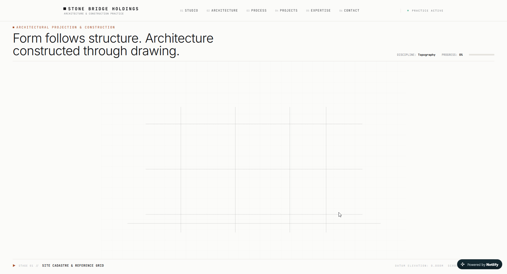
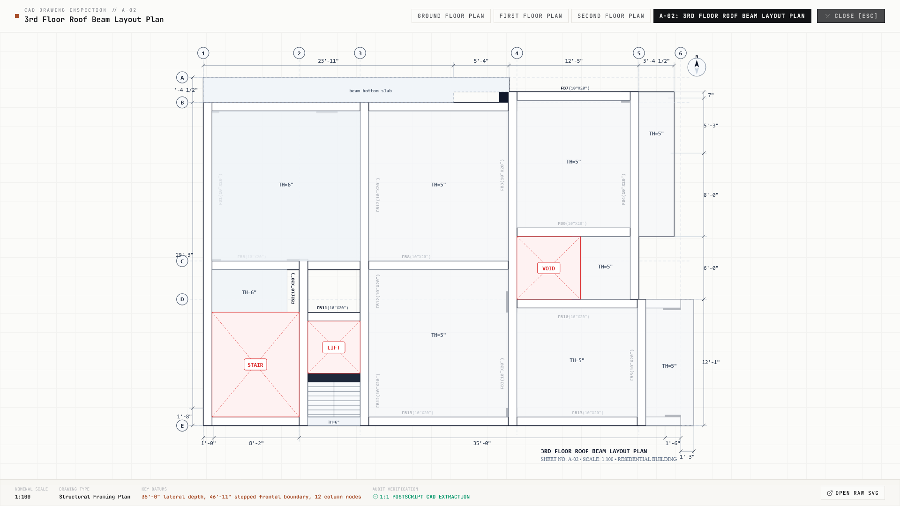
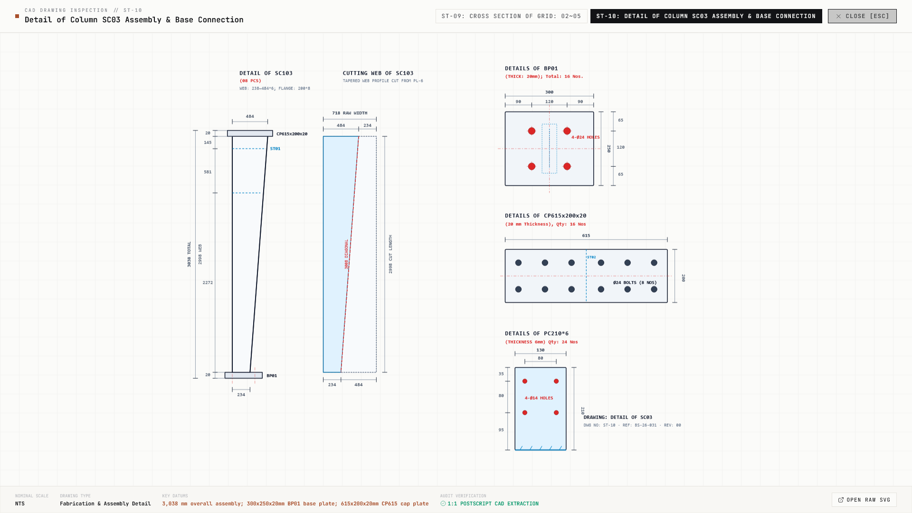
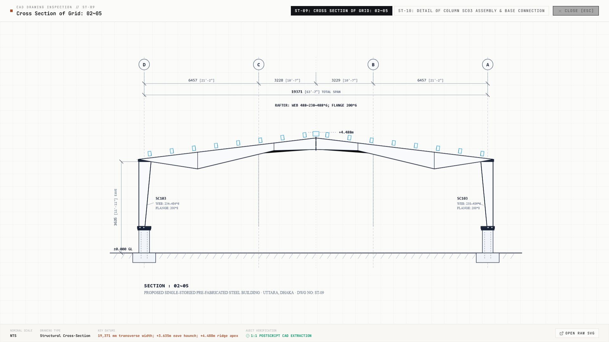

# Stone Bridge Holdings Limited

An architecture and construction portfolio that uses scroll-driven drawings to reveal how a building comes together. Its two case studies let visitors move from a project overview to structural drawings, floor plans, and interior renders where available.

[Live Netlify preview](https://stonebridgeholdings-website.netlify.app/) · [Project index](https://stonebridgeholdings-website.netlify.app/projects)



[View the completed elevation as a still image](docs/screenshots/homepage-hero.png)

## Project case studies

### Signature: Luxury Duplex Complex

A proposed residential development in Basundhara, Dhaka. The case study includes ground, first, and second floor plans, a roof beam layout, and an interior render gallery showing spaces such as the double-height living room.

[Explore the duplex case study](https://stonebridgeholdings-website.netlify.app/projects/proposed-g6-residential-basundhara)



### Pre-Fabricated Steel Car Showroom

A proposed showroom in Uttara, Dhaka. Its two drawing sheets show how a steel portal frame spans the showroom and how a tapered column connects to its base.

[Explore the showroom case study](https://stonebridgeholdings-website.netlify.app/projects/proposed-steel-car-showroom-uttara)

| Portal-frame cross-section (ST-09) | Column assembly and base connection (ST-10) |
| --- | --- |
| [](docs/screenshots/car-showroom-steel-cross-section.png) | [](docs/screenshots/car-showroom-column-connection.png) |

## How the site works

- **Scroll-driven drawings.** GSAP ScrollTrigger ties SVG animation to scroll position across four homepage scenes covering the building elevation, floor plan, construction sequence, and façade overlay. The scenes support reduced motion.
- **Drawing inspection.** Case studies offer an expanded viewer with sheet switching and Escape-to-close. The viewer supports vector drawings and raster floor plans.
- **Project content.** A typed data file supplies the project index and detail pages. Original engineering PDFs are the reference for project drawing geometry.

The site uses Next.js 15 (App Router), React 19, TypeScript, Tailwind CSS, GSAP, and SVG. The preview is hosted on Netlify.

## Run locally

With Node.js and npm installed:

```sh
npm ci
npm run dev
```

Open [localhost:3000](http://localhost:3000). Run `npm run build` to create a production build and `npm run start` to serve it locally.

## Repository guide

| Path | Contents |
| --- | --- |
| [`src/app/`](src/app/) | Homepage, project index, and case-study routes |
| [`src/data/projects.ts`](src/data/projects.ts) | Project descriptions and drawing and render records |
| [`src/components/animation/`](src/components/animation/) | Scroll animation scenes |
| [`public/assets/`](public/assets/) | SVG drawings and project imagery used by the site |
| [`docs/screenshots/`](docs/screenshots/) | Screenshots and animation recording from the Netlify preview |
| [`instructions/`](instructions/) | Design briefs, drawing audits, and implementation notes |

## Launch status

The Netlify deployment is a pre-launch preview. The contact details are placeholders, and the inquiry form only demonstrates the interface. See the [launch content checklist](FINAL-LAUNCH-CONTENT-CONFIGURATION.md) for the remaining company and project information.
